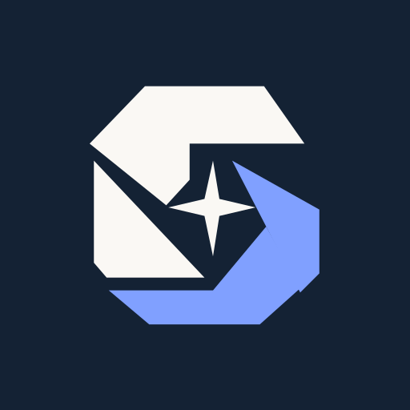

# Starglass Research

Starglass connects your AI host to selected official public records. Your host
supplies the reasoning and keeps the conversation. The MCP server provides
read-only source coverage, searches, bounded cited passages and mechanical
checks of supplied evidence. It does not call Parallel or a proprietary LLM.

## Account and connection

Create an account at [aculeus.ai/start](https://aculeus.ai/start), verify your
email, and activate the cardless 30-day trial at
[your Starglass account](https://aculeus.ai/account/starglass). Installing this
plugin does not create an account or activate a trial. After 30 days, research
pauses unless you explicitly choose the USD 49 monthly subscription. No automatic
trial conversion occurs. The offer includes 1,000 MCP source operations per UTC
calendar month and a separate USD 5 website Quick Answer provider-cost allowance
per trial or paid month; Aculeus absorbs the final admitted Quick Answer's
overrun. Customers have no overage charge. Your AI subscription, hosted Starglass
Deep Research and shared Starglass workspaces are separate.

This bundle supplies the research skill and a remote MCP connection at
`https://aculeus.ai/api/mcp`. Authenticate through the host's normal OAuth flow
with your Starglass account. Follow the
[connection guide](https://aculeus.ai/connect) for installation and other hosts.
The server exposes `sources_list`, `source_search`, `source_fetch` and
`evidence_check`. Check the live catalogue for source availability and limits.

## Start an investigation

Run `/starglass-research:investigate <question>`, or invoke the skill with
`/starglass-research:starglass-research <question>`. Claude may also load the
skill itself when you ask it to research a public-record question. In Codex,
send `$starglass-research <question>` after installing the skill; if you
installed it before 0.3.0, run `npx skills update starglass-research` (or re-run
the `npx skills add` command), then start a new session. Other MCP clients can
use the server's `investigate` prompt once MCP server 0.3.6, which ships it,
is deployed to aculeus.ai; it is not available before that deployment.

Invocation tells your AI host to start adaptive intake. The skill instructs the
host to restate your question, check the Starglass catalogue and ask the single
most consequential missing decision (it accepts "I don't know"), then show an
editable Case Plan and ask "Proceed with this plan, or change anything?" The
instructions make source searches and fetches wait for your approval of the plan
you have seen; a question or change returns to the plan. Invoking the skill is
not plan approval, and neither invoking it nor approving a plan authorizes
sending private data. One or two fields of one named record, or an explicit
quick lookup that stays within one record or one source family, skip the plan
loop; a quick request that needs multi-source or multi-page acquisition still
gets the plan. Pass a saved case folder to the command to resume an approved
case without repeating intake; the host is instructed to restate the saved scope
and next action and ask you to confirm before new acquisition. These are
instructions to your host; no native host test of this start flow is claimed
yet. This is host-led research; hosted Starglass Deep Research is a separate
product and is not included in the USD 49 plan.

The plugin starts enabled from version 0.3.0 unless you have already set it.
The bundled `starglass-reviewer` subagent runs the skeptical review in a separate
context with read-only file tools and Starglass `source_fetch` and
`evidence_check`. It inherits the session's model, so it is not a second model.
Its `source_fetch` calls reopen records already in the case and count toward
your monthly source operations.

## What runs and where data goes

The host sends research tool inputs to the Starglass MCP server, which retrieves
records from its supported official-source APIs and returns passages, canonical
URLs, retrieval dates, locators and hashes. Account and aggregate quota
bookkeeping remain on Aculeus. The MCP does not store your research files or
final reports. Website Quick Answer is a separate feature, outside these four
MCP tools.

Claude Code also runs the bundled Node.js
[capture hook](scripts/capture.js) after matching Starglass tool calls. It writes
successful tool-event evidence into the current case directory only when that
directory contains the explicitly authorized `.starglass-capture.json` marker.
With that marker, it saves the allowed session/tool identifiers, tool input and
tool response under `.starglass-evidence/<session-id>/<tool-use-id>.json`; it
omits unrelated transcript paths, server details and headers. Node.js 18 or later
must already be available; the plugin does not install it. The hook makes no
network requests, does not replace tool output and rejects linked or escaping
paths. It is not a sandbox against another process with write access. Read the
[opt-in instructions and limits](skills/starglass-research/references/evidence-bundle.md)
before enabling local capture. Without the marker it does not save evidence.
ChatGPT and Codex use their actual chat/file capabilities; this hook does not
provide equivalent automatic capture in those hosts.

## Coverage and support

Supported source families are USAspending, SEC filings, FEC committee
registrations, identified congressional bills, GovInfo publications, lobbying
disclosures and NPPES organization records. This is not a complete funding
ledger, licensure check, tax/audit extractor or arbitrary-URL crawler. Empty
results do not prove absence. Mechanical evidence checks do not certify truth
or complete coverage. Use the [research workflow](skills/starglass-research/SKILL.md)
to keep gaps and provenance visible.

Publisher: Aculeus, Inc. Support and privacy requests:
[jeremy@aculeus.ai](mailto:jeremy@aculeus.ai).
[Privacy](https://aculeus.ai/privacy) · [Terms](https://aculeus.ai/terms) ·
[MIT license](LICENSE).
